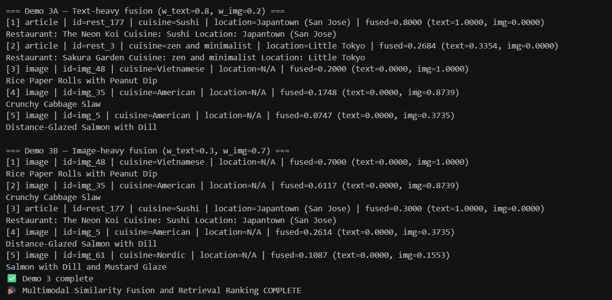
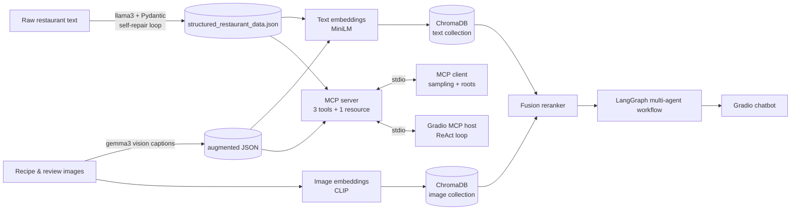

# Connoisseur Companion

An AI assistant that recommends California restaurants and recipes. It structures messy restaurant text with a local LLM, indexes text and images in a multimodal vector store, orchestrates specialised agents with LangGraph, and exposes the data through an **MCP (Model Context Protocol) server** consumed by a Gradio chat app.

Everything runs locally with [Ollama](https://ollama.com), with no paid API needed for the core app.


## Highlights

- **Reliable LLM extraction.** Free-text restaurant descriptions become typed records: a Pydantic schema validates each output and a *self-repair loop* sends validation errors back to the model (up to 5 retries) until the JSON is valid.
- **Multimodal RAG.** Text embeddings (`all-MiniLM-L6-v2`, 384-d) and image embeddings (CLIP `clip-vit-base-patch32`, 512-d) live in two ChromaDB collections, with metadata filtering and a weighted **fusion reranker** that blends text and image similarity.
- **Multi-agent orchestration.** Six role-based agents (user profile, retriever, trend analyst, food-style expert, nutrition expert, recommender) wired as a **LangGraph** state graph, with the analysis nodes running in parallel.
- **MCP server, client and host.** A FastMCP server exposes 3 tools and 1 resource; a client demonstrates tool calls, **sampling** and **roots**; a Gradio app acts as an MCP host running a ReAct loop over the discovered tools.
- **Tested and reproducible.** `pytest` suite (LLM mocked, MCP exercised in memory), dataset quality checks, `ruff`, and CI on every push.



## Architecture



## Repository layout

```
src/connoisseur/
  server.py           FastMCP server: get_restaurant_info, recommend_by_vibe, get_review
  client.py           MCP client demo: tool calls, sampling (Claude) and roots
  app.py              Gradio chat UI acting as an MCP host (ReAct loop on Ollama)
  data_management.py  LLM structuring + Pydantic validation + console CRUD
  config.py           paths and model names, overridable via env vars
notebooks/            step-by-step pipeline, 01 extraction -> 08 Gradio chatbot
data/                 structured_restaurant_data.json, augmented_user_review.json
scripts/              download_data.py (third-party datasets)
tests/                pytest suite
```

## Quickstart

Requirements: Python 3.12+ and [Ollama](https://ollama.com) running locally.

```bash
ollama pull llama3 && ollama pull llama3.1 && ollama pull gemma3

python -m venv .venv && source .venv/bin/activate      # Windows: .venv\Scripts\activate
pip install -e .                                        # core app
pip install -e ".[notebooks]"                           # optional: notebooks 03-08
cp .env.example .env                                    # optional settings

python scripts/download_data.py                         # raw IBM text/datasets (see Credits)

python -m connoisseur.app                               # chat UI (add --share for a public link)
python -m connoisseur.client                            # MCP client demo (needs ANTHROPIC_API_KEY)
python -m connoisseur.data_management                   # console tool to browse/add/edit restaurants
```

The notebooks are meant to be run in order. Notebooks 03-05 share a persistent ChromaDB index (`CHROMA_DIR`, default `~/chroma_multimodal`), so run notebook 03 first. Notebook 03 also downloads the recipe images (~210 MB).

### Tests

```bash
pip install -e ".[dev]"
pytest
ruff check src tests scripts
```

## Technical notes

- **Why a self-repair loop.** Small local models often return almost-valid JSON. Feeding the exact Pydantic error back to the model fixes most cases without a larger model or constrained decoding.
- **Why two embedding spaces.** Text and image vectors are not comparable, so each lives in its own collection. The fusion reranker min-max normalises scores per modality and combines them with `w_text` / `w_img`, so you can bias results toward text or images.
- **Why MCP.** Putting the data behind an MCP server decouples it from the UI: the same server is used by the demo client and by the Gradio host, and any MCP-capable assistant could use it too.
- **Local-first.** Chat, extraction and captioning use Ollama models; Anthropic is only used by the MCP client's sampling demo.

## Known limitations

- `price_range` comes from LLM extraction and is imperfect: some `$$$$` entries were recorded as 3, and 42 of the 201 restaurants have no price (`null`). The dataset-quality tests check ranges and schema, not factual accuracy.
- The source text contains a few duplicated restaurant descriptions, so some names appear twice.
- Answer quality depends on the local models you run; smaller models make more extraction and tool-calling mistakes.

## Credits

This project grew out of the IBM **RAG and Agentic AI** course (Coursera). The dataset sources (`California-Culinary-Map.txt`, `Recipes.json`, `Synthetic-User-Reviews.json` and the synthetic recipe images) belong to IBM and are **not redistributed**; `scripts/download_data.py` fetches them from their original location. `data/structured_restaurant_data.json` and `data/augmented_user_review.json` are derived outputs produced by running the notebooks with local models. The course provided the scenario, datasets and lab scaffolding; the code here was reworked to run fully locally with Ollama and extended with the packaging, tests, CI and dataset-quality checks.

Licensed under the [MIT License](LICENSE).
