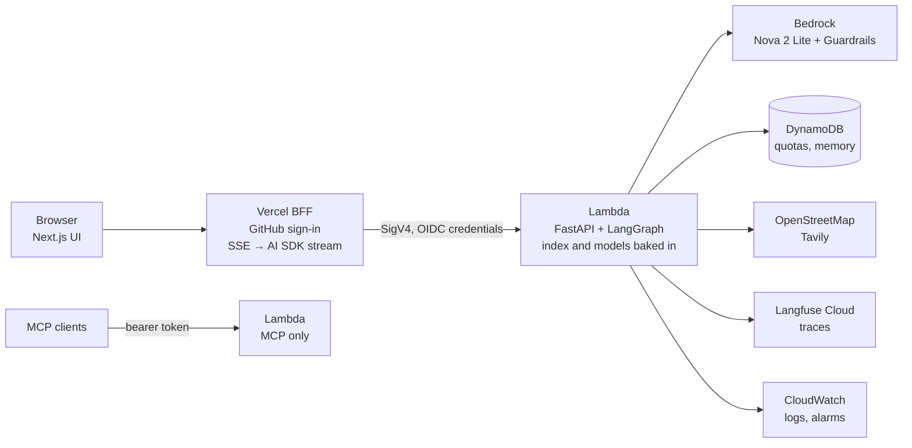
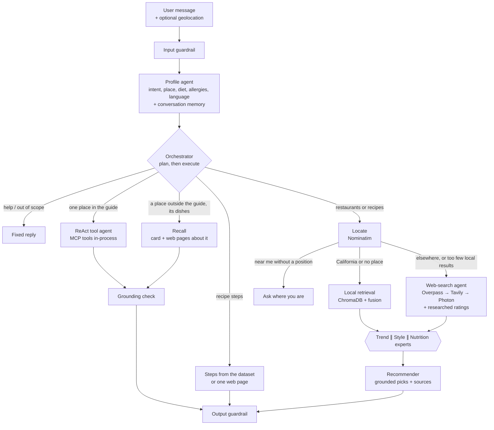

# Connoisseur Companion

An AI assistant that recommends restaurants anywhere in the world and recipes to cook at home, in English or Spanish. A **LangGraph multi-agent workflow** understands the request, searches a curated California guide with **multimodal RAG** or real places nearby on **OpenStreetMap** and the web, and returns **grounded** recommendations: every place, rating, dish and recipe step shown comes from a source it links to.

It runs in production on **AWS Lambda + Amazon Bedrock** behind a **Next.js app on Vercel**, deployed with **Terraform** and **GitHub Actions (OIDC)**, traced in **Langfuse**, attacked by a **red-team suite** and measured by **evaluation suites**, for **$1.39 in its first month**. Locally the same code runs on [Ollama](https://ollama.com) with no cloud account.


## What it shows

| Area | In this project |
|---|---|
| Agents | LangGraph workflow with a profile/router agent, a deterministic web-search agent, three parallel expert agents, a grounded recommender, a ReAct lookup agent over MCP tools, and a plan-then-execute orchestrator for compound requests ([ADR 0005](docs/adr/0005-fixed-graph-with-optional-orchestrator.md)) |
| RAG | MiniLM text + CLIP image embeddings in ChromaDB with a per-recipe fusion reranker; images lift visual-description search from MRR 0.52 to 0.90 |
| Grounding | Picks must cite retrieved ids; ratings are parsed from review pages, never generated; dishes and web recipes are kept only if found literally on the cited page; a grounding check cut invented facts from 27% to 7% |
| Security | OWASP LLM Top 10 threat model, layered guardrails (Prompt Guard 2 + rules + Bedrock Guardrails), spotlighting of untrusted content, deterministic allergy safety, read-only tools, quotas. Red team: 16/16 ([SECURITY.md](SECURITY.md)) |
| Evaluation | Retrieval, profile, end-to-end, multi-turn and hallucination-rate suites, with an LLM judge calibrated against hand labels; model bake-off across five Bedrock models ([report](docs/evals/report.md)) |
| Memory | Per-conversation profile and last picks, per-user city, diet and allergies, in DynamoDB with TTL, visible in the UI with a "forget" button |
| Cloud | Lambda container with IAM Function URL, Bedrock, DynamoDB, SSM, ECR, CloudWatch alarms and saved queries, AWS Budgets; Terraform checked by tflint and checkov; image scanned by Trivy; no long-lived keys anywhere |
| Operations | One Langfuse trace per message, structured JSON logs, [runbook](docs/runbook.md), [architecture decision records](docs/adr/README.md) |

## Architecture

**Request path.** The browser never talks to AWS directly: a backend-for-frontend on Vercel checks the GitHub session and signs each call with short-lived credentials from Vercel OIDC ([ADR 0004](docs/adr/0004-vercel-frontend-lambda-backend.md)).



**Agent workflow.** Every message passes an input guardrail, then the profile agent. The orchestrator (on in production) chooses one or more of the branches below as tools; if it fails, the fixed routing answers. Answers pass an output guardrail.



## Results

**Ollama on a laptop vs Bedrock in production** (details and method in the [evaluation report](docs/evals/report.md)):

| Measure | `llama3.1` 8B on Ollama | Nova 2 Lite on Bedrock |
|---|---|---|
| Profile agent, 30 cases with every field right | 29 / 30 | **30 / 30** |
| End to end, deterministic checks (routing, tools, refusals, allergies, no invented facts) | 20 / 21 | **21 / 22** (the miss is a known guardrail false positive) |
| End to end, median answer time | 28.5 s | **5.4 s** |
| End to end, relevance (judge, 1-5) | 4.75 | **4.92** |
| End to end, groundedness (judge) | 0.60 | 0.33: the recommender's reasons embellish more, and the 8B judge misses some support |
| Multi-turn memory, 14 conversations | not run (too slow locally) | **14 / 14** with the orchestrator, 13 / 14 without |
| Red team, 16 attacks and controls | 15 / 16 (local guardrails) | **16 / 16** (Bedrock Guardrails + local screen) |

Other findings worth reading:

- **Retrieval:** text search finds a recipe by ingredients with MRR 0.92; CLIP image embeddings raise search by visual description from 0.52 to 0.90.
- **Hallucination rate:** asked questions the guide cannot answer, the lookup agent invented facts in 27% of answers; a grounding check brought it to 7%.
- **Evals found product bugs** that unit tests did not: allergy-safety claims in new wordings, memory making extraction mistakes stick, a managed guardrail that missed a Spanish injection, and test suites that leaked state between cases.
- **The open problem:** with Nova 2 Lite the recommender's free-text reasons embellish (two non-Italian places called "Italian"). Picks are always real and sourced, but their reasons are not yet checked; that is the next step.

**Cost** (October 2026, Cost Explorer, including every evaluation and red-team run):

| Bedrock | ECR | Lambda, DynamoDB, CloudWatch, SSM, S3 | Vercel, Langfuse, Tavily | Total |
|---|---|---|---|---|
| $1.37 | $0.02 | $0.00 | free tiers | **$1.39** |

At demo traffic a conversation costs about half a cent. Why it is this cheap: [ADR 0001](docs/adr/0001-bedrock-instead-of-gpu.md) (Bedrock on demand instead of a GPU) and [ADR 0002](docs/adr/0002-lambda-instead-of-ecs.md) (Lambda instead of an always-on container).

**Tracing:** one Langfuse trace per message, with the graph nodes, every generation (tokens, latency), retrieval, geocoding, web and MCP tool spans, and guardrail decisions; coordinates, emails, phones and secrets are masked before export.


## Documentation

| Document | For |
|---|---|
| [SECURITY.md](SECURITY.md) | Threat model, controls, guardrail providers, what the red team changed |
| [docs/evals/report.md](docs/evals/report.md) · [method](docs/evals/README.md) | Every evaluation run, the model bake-off and what each run fixed |
| [docs/security/redteam-report.md](docs/security/redteam-report.md) | Latest red-team results and history |
| [docs/adr/](docs/adr/README.md) | Why Bedrock, Lambda, ONNX, Vercel + Lambda and the orchestrator |
| [docs/runbook.md](docs/runbook.md) | Health checks, alarms, known problems, rollback, emergency stop, costs |
| [docs/tutorial-terraform-aws.md](docs/tutorial-terraform-aws.md) | Step-by-step AWS deployment with costs and teardown (Spanish) |
| [web/README.md](web/README.md) | The Next.js frontend and its backend-for-frontend |

## Repository layout

```
src/connoisseur/
  api.py              FastAPI app: /chat (SSE), /chat/sync, /memory, /feedback, /mcp, /ui, /health
  agents/             LangGraph graph, nodes, orchestrator + its tools (skills), ReAct tool agent, grounding check, prompts (*.md)
  retrieval/          fastembed embeddings, ChromaDB store, fusion reranker, search service
  places/             OpenStreetMap (Nominatim, Overpass, Photon), Tavily, ratings, dishes, web place discovery, TTL cache
  security/           guardrails, injection screening, spotlighting, allergens, quotas, PII redaction
  memory.py           conversation and user memory (in memory locally, DynamoDB on AWS)
  recipes_web.py      recipes from the web for dishes the dataset lacks, checked against the page
  server.py           FastMCP server: 5 read-only tools + culinary map resource
  llm.py              provider factory (Ollama / Bedrock)
  settings.py         typed settings from env vars / .env (and SSM Parameter Store on AWS)
  observability.py    Langfuse tracing, masking, scores
web/                  Next.js frontend (Vercel): chat UI, map, sign-in, memory chips, backend-for-frontend
infra/terraform/      AWS: ECR, Lambda + Function URL, Bedrock Guardrail, DynamoDB, SSM, IAM/OIDC, CloudWatch, Budgets
infra/langfuse/       docker-compose for a local Langfuse
Dockerfile            Lambda container image (Lambda Web Adapter, index and ONNX models baked in)
evals/                evaluation suites, datasets, recorded web fixtures, LLM judge
redteam/              promptfoo adversarial suite against the running API
scripts/              download_data.py, build_index.py, sync_prompts.py, warm_models.py
notebooks/            the original step-by-step course pipeline, 01 extraction -> 08 chatbot
tests/                pytest suite (LLM and network faked)
```

## Quickstart (local, no cloud)

Requirements: Python 3.12+, Node 22 and [Ollama](https://ollama.com) running locally.

```bash
ollama pull llama3.1 && ollama pull llama3 && ollama pull llama-guard3:1b

python -m venv .venv && source .venv/bin/activate      # Windows: .venv\Scripts\activate
pip install -e ".[ui]"                                  # API + developer UI
cp .env.example .env                                    # optional settings (Tavily key, models...)

python scripts/download_data.py --with-images           # raw IBM datasets (see Credits)
python scripts/build_index.py                           # vector index in .chroma/ (~1 min, CPU)

uvicorn connoisseur.api:app --reload                    # API + Gradio dev UI at http://localhost:8000/ui

cd web && cp .env.example .env.local && npm install
npm run dev -- -p 3001                                  # web app at http://localhost:3001
```

Other entry points:

```bash
curl -N localhost:8000/chat -H "content-type: application/json" \
     -d '{"message": "a quiet vegan cafe in El Poblado, Medellín"}'
python -m connoisseur.client                            # MCP client demo (sampling runs on Ollama)
python -m connoisseur.data_management                   # console tool to browse/add/edit restaurants
```

Local tracing: `docker compose -f infra/langfuse/docker-compose.yml up -d` (Langfuse at http://localhost:3000, login `dev@connoisseur.local` / `connoisseur-dev`, keys `pk-lf-local-dev` / `sk-lf-local-dev` in `.env`).

### Tests, evaluations and red team

```bash
pip install -e ".[dev]"
pytest                                     # LLM and HTTP faked; index tests run only if .chroma/ exists
ruff check src tests scripts redteam evals
cd web && npm run lint && npm run typecheck && npm test

python -m evals.run --suite retrieval      # no LLM, ~1 min
python -m evals.run --suite all            # judge calibration, profile, end to end (LLM)
python -m evals.run --suite multiturn      # memory across turns and chats
python -m evals.repeat --n 5               # hallucination rate with and without the grounding check

npx promptfoo@0.120.19 eval -c redteam/promptfooconfig.yaml   # against a running API, see the report
```

CI runs ruff, pytest, Bandit, nbstripout, the web lint/typecheck/tests/build, gitleaks, `terraform fmt`, tflint and checkov on every push and pull request. Pull requests that touch the backend also build the image, start it on a read-only filesystem and scan it with Trivy.

## Deploy to AWS

The backend is a Lambda container behind a Function URL with IAM auth; only the Vercel project's OIDC role can call it. The LLM is Nova 2 Lite on Bedrock, the guardrail is Bedrock Guardrails with the local injection screen in front. Quotas and memory live in DynamoDB, secrets in SSM Parameter Store. Terraform is applied by hand; GitHub Actions builds, scans and deploys new images from `main` through OIDC.

```bash
cd infra/terraform
terraform init -backend-config=backend.hcl
terraform apply -target=module.ecr                       # registry first
docker buildx build --platform linux/amd64 --provenance=false -t <ecr-url>:bootstrap --push .
terraform apply                                         # everything else
```

Full walkthrough with costs per resource, console checks, common errors and teardown: [docs/tutorial-terraform-aws.md](docs/tutorial-terraform-aws.md) (Spanish). Day-2 operations: [docs/runbook.md](docs/runbook.md).

## Technical notes

- **Fixed text where the model failed.** Help text, dish lists and recipe steps are assembled by code: an LLM-written greeting invented a restaurant with an address and a phone number, and Nova Lite wrote placeholders such as `<link_to_menu>` when asked to introduce a dish list.
- **Required fields in LLM schemas.** With schema-constrained decoding, a schema whose fields are all optional lets a small model answer `{}`. Every field is required (nullable where needed), and a partial answer is completed with defaults instead of dropped.
- **Code decides what memory keeps.** The model extracts each message; `memory.merge_profile` decides what carries over. Allergies only accumulate, a topic switch resets cuisines, and placeholders such as "(user's location)" are discarded, because memory made extraction mistakes stick for a whole conversation.
- **References resolved in code.** "El segundo", "the last one" and "there" are resolved against the numbered cards of the previous answer, not by the model, which passed the wrong restaurant name when asked to.
- **A deterministic web agent.** Letting an LLM pick tools from web pages invites indirect prompt injection. The web branch always runs the same steps, and web text reaches the recommender wrapped as untrusted data.
- **A Lambda-shaped container.** The filesystem is read-only except `/tmp`, so the baked index is copied there at cold start and models load offline. CI runs the image with `docker run --read-only` and loads Prompt Guard as a non-root user, the way Lambda does.
- **Being a good OSM citizen.** Nominatim calls are throttled to 1 per second, results are cached, Overpass falls back across public mirrors with backoff and a circuit breaker, and answers credit OpenStreetMap contributors.

## Known limitations

- `price_range` comes from LLM extraction and is imperfect: some `$$$$` entries were recorded as 3, and 42 of the 201 restaurants have no price.
- Restaurant search by signature dish is the weakest retrieval case (hit@1 0.475); hybrid lexical + semantic search is the next experiment.
- The grounding check lowers invented facts on the lookup path to 7%, not zero, and does not yet cover the recommender's free text, where Nova 2 Lite embellishes (cuisine or vibe the record does not have).
- Reference resolution and intent fixes are regular expressions tuned on English and Spanish; other languages fall back to the model alone.
- OpenStreetMap coverage varies by city, and Tavily's free tier (1,000 credits a month) limits web research.
- Cold starts take 10 to 30 seconds after a quiet period.

## Credits

This project grew out of the IBM **RAG and Agentic AI** course (Coursera). The dataset sources (`California-Culinary-Map.txt`, `Recipes.json`, `Synthetic-User-Reviews.json` and the synthetic recipe images) belong to IBM and are **not redistributed**; `scripts/download_data.py` fetches them from their original location. `data/structured_restaurant_data.json` and `data/augmented_user_review.json` are derived outputs produced by running the notebooks with local models. The course provided the scenario, datasets and lab scaffolding; the code here was reworked to run fully locally with Ollama and extended with the production API, real retrieval in the agent workflow (the course notebook simulated it with the LLM), the web-search and orchestration agents, memory, security, evaluations, the web app and the AWS deployment. Place data from OpenStreetMap is © OpenStreetMap contributors, available under the ODbL.

Licensed under the [MIT License](LICENSE).
