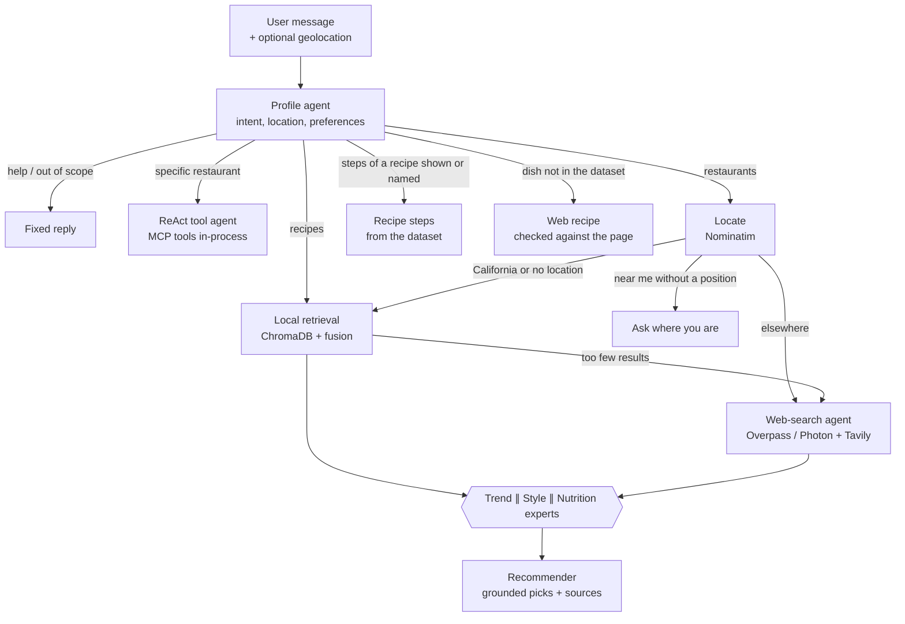
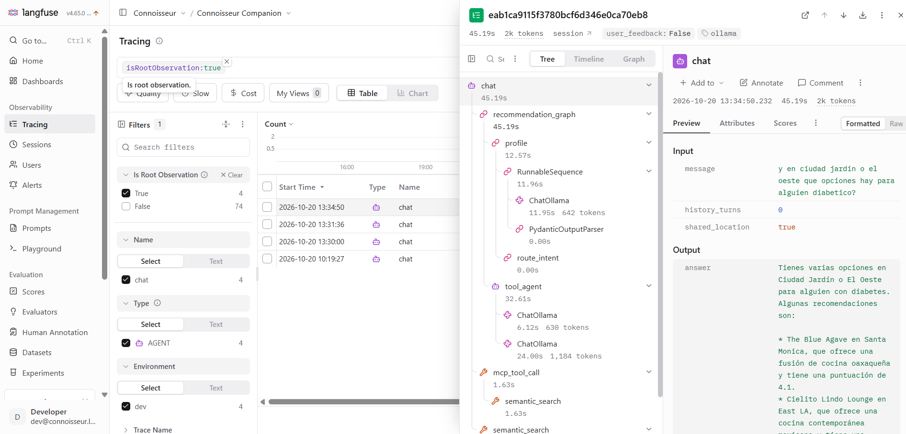

# Connoisseur Companion

An AI assistant that recommends restaurants anywhere in the world and recipes to cook at home. A **LangGraph multi-agent workflow** understands the request, searches a curated California guide with **multimodal RAG** or real places nearby on **OpenStreetMap**, has three expert agents review the options in parallel, and returns **grounded** recommendations. The same data is exposed through an **MCP (Model Context Protocol) server**.

Everything runs locally with [Ollama](https://ollama.com): no paid LLM API is needed. The provider layer can switch to Amazon Bedrock for cloud deployment.


## Highlights

- **Profile agent + router.** One structured LLM call extracts intent, location, cuisines, diet, vibe, budget and language, then routes to the right branch.
- **Hybrid orchestrator (optional).** With `ORCHESTRATOR_ENABLED=true` an LLM chooses, per message, which high-level tools to use (restaurants, one place's info or dishes, recipes, recipe steps, a question back), one or several in a row. Each tool is deterministic and grounded inside and writes its own part of the answer; the orchestrator only sees counts and names tagged as data, so web content cannot steer it. It plans its calls once (plan, then execute) and falls back to the fixed routing on any failure. On the multi-turn suite it serves compound requests the fixed graph cannot (14/14 vs 13/14) for about 2 s more per conversation.
- **Recipes that follow up.** "¿Cómo preparo la segunda?" returns that recipe's ingredients and steps from the dataset; a dish the dataset lacks ("receta de ajiaco") is read from one web page, and only ingredients and steps found on that page are shown, with the link.
- **Web-search agent.** Outside California (or when the guide has too few matches) it geocodes the location with Nominatim, finds restaurants with Overpass (falling back to Photon when Overpass is busy), ranks them by cuisine and `diet:*` tags, and, with a Tavily key, researches ratings for the top places on review sites. It is deterministic on purpose: web content never decides which tool runs next.
- **Researched ratings, not generated ones.** Ratings for web places are parsed with regular expressions from review snippets that mention the place by name, normalised to a 0-5 scale, averaged with one value per site, and shown with their source and link (e.g. "⭐ 4.6/5 Tripadvisor, 1,234 reviews"). The LLM never produces a rating.
- **"Near me" that is honest.** Browser geolocation is optional and rounded to ~1 km before it leaves the page. Without a position, the agent asks where you are instead of answering from the California guide, and a place named in the message wins over the device position.
- **Multimodal RAG.** MiniLM text embeddings and CLIP image embeddings (ONNX via `fastembed`, no torch) in ChromaDB. Recipes are ranked by a **fusion reranker** that merges text and image similarity per recipe.
- **Grounded answers.** The recommender may only cite retrieved candidate ids; any invented place is dropped before the answer is shown, and every pick shows its source.
- **MCP server.** 5 read-only tools and 1 resource, served in-process to the agents and over Streamable HTTP at `/mcp/` for any MCP client.
- **Agent security.** Input and output guardrails (Llama Prompt Guard 2 + English/Spanish injection rules + Llama Guard 3 locally, Bedrock Guardrails on AWS), untrusted tool and web content screened and isolated, read-only tools, per-user quotas, timeouts and bearer tokens. Threat model in [SECURITY.md](SECURITY.md), adversarial results in the [red-team report](docs/security/redteam-report.md).
- **Measured, not assumed.** Evaluation suites for retrieval (hit@k, MRR, image-weight sweep), the profile agent, end-to-end behaviour and hallucination rate, with an LLM judge that is itself calibrated against hand labels. Highlights: images lift visual-description search from MRR 0.52 to 0.90; a grounding check cuts invented facts from 27% to 7%. See the [evaluation report](docs/evals/report.md).
- **Observability with Langfuse.** One trace per request with the LangGraph nodes, every LLM generation (tokens, latency), retrieval, geocoding, OSM, Tavily and MCP tool spans, grouped by session. Prompts can be served from Langfuse Prompt Management, thumbs up/down become scores, and user coordinates, secrets, emails and phone numbers are masked before anything leaves the process.
- **Web app.** Next.js 16 on Vercel with GitHub sign-in, streamed agent steps, source-labelled cards, an OpenStreetMap map, opt-in geolocation and feedback. A backend-for-frontend keeps keys server-side and translates the API's events into the Vercel AI SDK protocol. Details: [web/README.md](web/README.md).
- **Production-minded.** Typed settings, provider factory (Ollama / Bedrock), structured logs with request ids, SSE streaming API, HTTP caching and retries for public OSM servers, and a `pytest` suite with the LLM and the network faked.

## Architecture



With `ORCHESTRATOR_ENABLED=true`, the profile agent hands over to an orchestrator instead of the fixed arrows: it calls these same branches as tools (`search_restaurants`, `place_info`, `search_recipes`, `recipe_steps`, `ask_user`, `answer_canned`) and joins their sections into one answer ([agents/orchestrator.py](src/connoisseur/agents/orchestrator.py), [agents/skills.py](src/connoisseur/agents/skills.py)).

```
Browser ── Next.js (Vercel) ── /api/chat BFF ──► FastAPI
            GitHub sign-in      session, user id,
            AI SDK useChat      SSE → UI message stream

FastAPI  ── POST /chat (SSE)   ── LangGraph workflow ── Ollama | Bedrock
         ── POST /chat/sync
         ── POST /feedback (Langfuse score)
         ── /mcp/  (MCP Streamable HTTP)
         ── /ui    (Gradio developer UI)
         ── GET /health
```

## Repository layout

```
src/connoisseur/
  api.py              FastAPI app: /chat (SSE), /chat/sync, /mcp, /ui, /health
  agents/             LangGraph graph, nodes, ReAct tool agent, orchestrator + its tools (skills), runner, prompts (*.md)
  recipes_web.py      recipes from the web for dishes the dataset lacks, checked against the page
  retrieval/          fastembed embeddings, ChromaDB store, fusion reranker, search service
  places/             OpenStreetMap (Nominatim + Overpass), Tavily, TTL cache
  security/           guardrails, prompt-injection screening, spotlighting, quotas, PII redaction
  server.py           FastMCP server: 5 read-only tools + culinary map resource
  llm.py              provider factory (Ollama / Bedrock)
  settings.py         typed settings from env vars / .env (and SSM Parameter Store on AWS)
  aws.py              AWS-only helpers (SSM secrets loader)
  schemas.py          shared Pydantic contracts
  app.py              Gradio developer UI
  client.py           MCP client demo: tool calls, sampling and roots
  data_management.py  LLM structuring with a self-repair loop + console CRUD
scripts/              download_data.py, build_index.py, sync_prompts.py, warm_models.py
infra/langfuse/       docker-compose for a local Langfuse
infra/terraform/      AWS deployment: ECR, Lambda + Function URL, Bedrock Guardrail, DynamoDB, SSM, IAM/OIDC, CloudWatch, Budgets
Dockerfile            Lambda container image (Lambda Web Adapter, index and ONNX models baked in)
redteam/              promptfoo adversarial suite against the running API
evals/                evaluation suites, datasets, recorded web fixtures, LLM judge
notebooks/            the original step-by-step pipeline, 01 extraction -> 08 chatbot
tests/                pytest suite
web/                  Next.js frontend (Vercel): chat UI, map, sign-in, backend-for-frontend
```

## Quickstart

Requirements: Python 3.12+ and [Ollama](https://ollama.com) running locally.

```bash
ollama pull llama3.1 && ollama pull llama3 && ollama pull llama-guard3:1b

python -m venv .venv && source .venv/bin/activate      # Windows: .venv\Scripts\activate
pip install -e ".[ui]"                                  # API + developer UI
cp .env.example .env                                    # optional settings (Tavily key, models...)

python scripts/download_data.py --with-images           # raw IBM datasets (see Credits)
python scripts/build_index.py                           # vector index in .chroma/ (~1 min, CPU)

uvicorn connoisseur.api:app --reload                    # API + Gradio dev UI at http://localhost:8000/ui

cd web && cp .env.example .env.local && npm install
npm run dev -- -p 3001                                  # web app at http://localhost:3001
```

Other entry points:

```bash
curl -N localhost:8000/chat -H "content-type: application/json" \
     -d '{"message": "a quiet vegan cafe in El Poblado, Medellín"}'
python -m connoisseur.client                            # MCP client demo (sampling runs on Ollama)
python -m connoisseur.data_management                   # console tool to browse/add/edit restaurants
```

### Observability (optional)

```bash
docker compose -f infra/langfuse/docker-compose.yml up -d   # Langfuse at http://localhost:3000
# login: dev@connoisseur.local / connoisseur-dev
# in .env: LANGFUSE_PUBLIC_KEY=pk-lf-local-dev  LANGFUSE_SECRET_KEY=sk-lf-local-dev
python scripts/sync_prompts.py                              # optional: publish prompts, then LANGFUSE_PROMPTS=true
```



### Evaluations

```bash
python -m evals.run --suite retrieval      # no LLM, ~1 min
python -m evals.run --suite all            # judge calibration, profile and end-to-end (LLM, ~1 h on a laptop)
python -m evals.repeat --n 5               # hallucination rate with and without the grounding check
```

Method: [docs/evals/README.md](docs/evals/README.md) · results: [docs/evals/report.md](docs/evals/report.md).

### Tests

```bash
pip install -e ".[dev]"
pytest              # LLM and HTTP are faked; index tests run only if .chroma/ exists
ruff check src tests scripts
```

## Deploy to AWS

The backend runs on AWS Lambda as a container image behind a Function URL with IAM auth. Only the Vercel frontend can call it, using short-lived credentials from Vercel OIDC. The LLM is Amazon Nova Lite on Bedrock and the guardrails are Bedrock Guardrails. Quotas live in DynamoDB, secrets in SSM Parameter Store. Everything is Terraform in [infra/terraform/](infra/terraform/), and GitHub Actions deploys new images from `main` through OIDC, with no stored AWS keys.

Step-by-step guide (in Spanish), with costs per resource, console checks, common errors and teardown: [docs/tutorial-terraform-aws.md](docs/tutorial-terraform-aws.md).

```bash
cd infra/terraform
terraform init -backend-config=backend.hcl
terraform apply -target=module.ecr                       # registry first
docker buildx build --platform linux/amd64 --provenance=false -t <ecr-url>:bootstrap --push .
terraform apply                                         # everything else
```

Expected cost for a demo: $1-5 a month, a few cents when idle.

## Technical notes

- **Why required fields in LLM schemas.** With schema-constrained decoding, a schema whose fields are all optional lets a small model answer `{}`. The extraction and recommendation schemas make every field required (nullable where needed), which fixed misrouted intents with `llama3.1`.
- **Why fixed help text.** An earlier version let the LLM answer greetings freely; it invented a restaurant with an address and a phone number. Help and refusals are now fixed text in English or Spanish.
- **Why a deterministic web agent.** Letting an LLM pick tools based on web pages invites indirect prompt injection. The web branch always runs the same steps, and web text reaches the recommender wrapped as untrusted data.
- **Why ONNX embeddings.** `fastembed` produces the same MiniLM and CLIP vectors as the notebooks without torch, which keeps the Lambda image at ~1.5 GB with the index and every model baked in.
- **A Lambda-shaped container.** Lambda's filesystem is read-only except `/tmp`, so the image copies the baked Chroma index to `/tmp` at cold start and loads models offline (`HF_HUB_OFFLINE=1`). CI runs the image with `docker run --read-only` to catch anything that writes elsewhere.
- **Who deploys what.** Terraform owns the infrastructure and is applied by hand; GitHub Actions only pushes images and updates the function code. The function ignores `image_uri` changes in Terraform, so an apply never rolls back a deploy.
- **Why per-entity fusion.** The notebook ranked text and image hits as separate rows. The package merges them per recipe, so a recipe that matches by text and by image ranks higher.
- **Being a good OSM citizen.** Nominatim calls are throttled to 1 per second, results are cached (geocoding for a month, places for a day), Overpass falls back across public mirrors with backoff, a circuit breaker skips Overpass for 5 minutes after it fails (Photon answers meanwhile), and answers credit OpenStreetMap contributors.

## Known limitations

- `price_range` comes from LLM extraction and is imperfect: some `$$$$` entries were recorded as 3, and 42 of the 201 restaurants have no price (`null`). The dataset-quality tests check ranges and schema, not factual accuracy.
- The source text contains a few duplicated restaurant descriptions, so some names appear twice.
- Answer quality depends on the local models you run; smaller models make more extraction and tool-calling mistakes.
- With the three expert agents enabled, a full recommendation takes about 1 minute on a laptop with `llama3.1` 8B. Set `ENABLE_EXPERT_ANALYSIS=false` for faster answers.
- OpenStreetMap coverage varies by city: some places have no cuisine or diet tags, which limits ranking.

## Credits

This project grew out of the IBM **RAG and Agentic AI** course (Coursera). The dataset sources (`California-Culinary-Map.txt`, `Recipes.json`, `Synthetic-User-Reviews.json` and the synthetic recipe images) belong to IBM and are **not redistributed**; `scripts/download_data.py` fetches them from their original location. `data/structured_restaurant_data.json` and `data/augmented_user_review.json` are derived outputs produced by running the notebooks with local models. The course provided the scenario, datasets and lab scaffolding; the code here was reworked to run fully locally with Ollama and extended with the packaging, the production API, real retrieval in the agent workflow (the course notebook simulated it with the LLM), the web-search agent, tests, CI and dataset-quality checks. Place data from OpenStreetMap is © OpenStreetMap contributors, available under the ODbL.

Licensed under the [MIT License](LICENSE).
