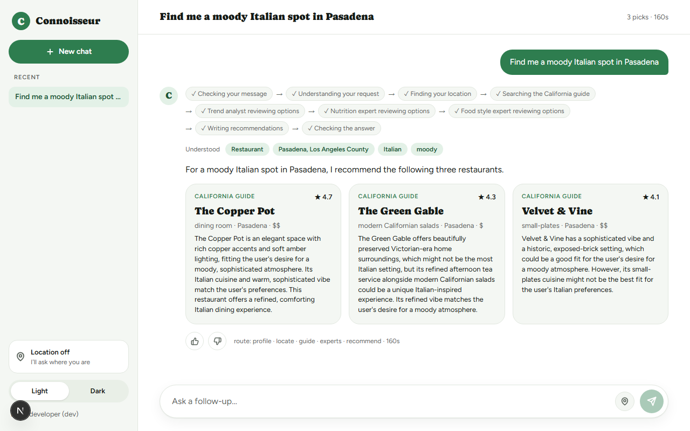

# Connoisseur Companion · web

Next.js 16 frontend for the Connoisseur Companion API. It streams the agent's steps, shows the answer with structured cards (each with its source), places on an OpenStreetMap map, an opt-in location button and 👍/👎 feedback.



## How it fits

```
Browser ──► Next.js (Vercel)
              ├─ page: GitHub sign-in (Auth.js), chat UI (AI SDK useChat): sidebar with recent chats,
              │        light/dark switch, agent steps, source-labelled cards, map, opt-in location
              └─ /api/chat  (backend-for-frontend)
                    ├─ checks the session
                    ├─ calls FastAPI /chat with the user id (per-user quotas)
                    │    · bearer API key, or SigV4 via Vercel OIDC on AWS (no stored AWS keys)
                    └─ translates the backend's SSE events into AI SDK UI message chunks
                         step → data-step · answer → text + data-result (cards, route, profile, trace id)
```

The browser never talks to the backend directly and never sees API keys, raw tool outputs or other users' data.

## Run locally

```bash
# 1. the backend, from the repo root
uvicorn connoisseur.api:app --reload            # http://localhost:8000

# 2. the frontend
cd web
cp .env.example .env.local                      # defaults point to localhost:8000
npm install
npm run dev -- -p 3001                          # http://localhost:3001 (3000 is Langfuse)
```

Without GitHub credentials, `next dev` runs as a local guest. To test sign-in, create a GitHub OAuth App with callback `http://localhost:3001/api/auth/callback/github` and fill `AUTH_GITHUB_ID`, `AUTH_GITHUB_SECRET` and `AUTH_SECRET`.

## Checks

```bash
npm run lint
npm run typecheck      # next typegen + tsc
npm test               # vitest: SSE parsing, event adapter, history limits, coordinate rounding
npm run build
```

## Security choices

- **Backend-for-frontend**: keys and backend URLs stay on the server; the route forwards only text history (no UI data) within the API's limits.
- **Location**: rounded to ~1 km in the browser, sent only while sharing is on, re-validated on the server.
- **Recent chats**: kept in this browser's `localStorage` only (last 20), never sent to the server except as the history of the chat you continue.
- **Headers**: a strict Content Security Policy (own scripts only; images from OSM tiles and GitHub avatars), `frame-ancestors 'none'`, `nosniff`, and `Permissions-Policy` that allows geolocation for this site only.
- **Markdown**: rendered with `react-markdown` (no raw HTML); links open with `rel="noopener noreferrer"`.
- **Auth**: production requires GitHub sign-in; the guest mode exists only in development.

## Deploy to Vercel

Deploy the AWS backend first ([docs/tutorial-terraform-aws.md](../docs/tutorial-terraform-aws.md), section 13 covers Vercel).

1. In Vercel, enable **OIDC Federation** in **Team** mode (Settings → Security). The role Terraform creates trusts `https://oidc.vercel.com/<team>` for this project's production environment only.
2. Import the GitHub repo with the project name used in Terraform (`vercel_project_name`) and **Root Directory** `web`.
3. Set the production environment variables: `BACKEND_URL` (`terraform output -raw api_url`, no trailing slash), `BACKEND_AUTH=aws_iam`, `AWS_ROLE_ARN` (`terraform output -raw vercel_role_arn`), `AWS_REGION`, `AUTH_SECRET`, `AUTH_GITHUB_ID` and `AUTH_GITHUB_SECRET`.
4. Set the GitHub OAuth App callback to `https://<your-domain>/api/auth/callback/github`.
